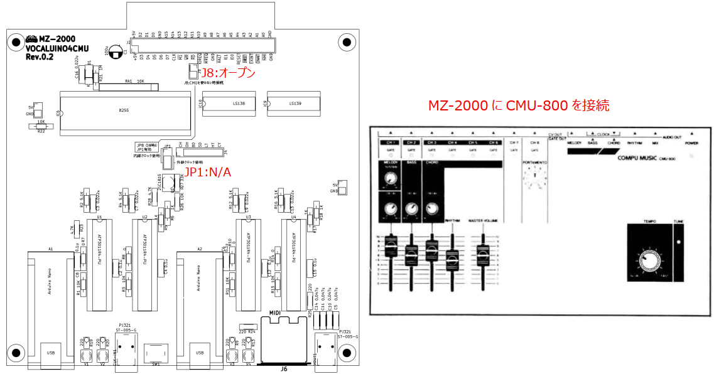
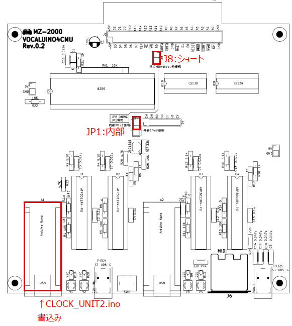
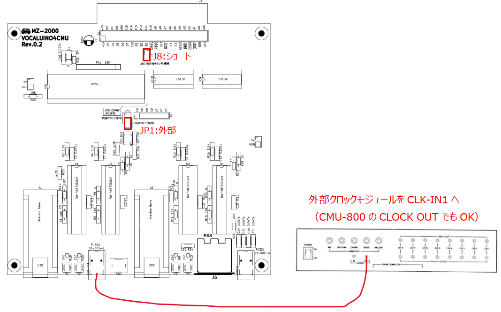

# MZ-2000_VOCALUINO4CMU(Rev.0.2)

MZ-2000 および CMU-800 システムに向けた音声合成（歌唱）機能および MIDI インタフェース拡張ボードです。CMU-800 のバス信号を傍受・エミュレートすることで、リアルタイムでの音声合成発音や MIDI 送出、ならびにテンポクロック生成による擬似 CMU-800 動作を実現します。

---
## 1. 概要と基本機能

### 基本機能

CMU-800 動作時にやり取りされるバス信号を傍受し、以下の動作を行います。

* **音声合成歌唱**: 音声合成 LSI（ATP3011R4-PU）を使用し、指定したチャンネルの音階に合わせて歌詞を歌わせます。

* **MIDI 信号送出**: CMU-800 の演奏データ（メロディ・コード・ドラム）を標準 MIDI 信号に変換して外部音源へ送出します。

### 追加機能

テンポクロックを取り込むことで、本ボード自身を CMU-800 のクロック源（擬似 CMU-800）として動作させることができます。テンポクロックの供給方法は以下の 2 通りから選択できます。

* 外部入力端子（CLK-IN1）から CMU_CLOCK_MODULE 等のクロックを入力。

* 基板上の Arduino Nano（A1）でテンポクロックを自己生成。

### 前提条件・必要環境

* **音声合成発音時**: 音声合成 LSI **ATP3011R4-PU** が必須です。

* **クロック自己生成時**: Arduino IDE のシリアルモニタ等（115200 bps）から BPM 設定を行います。

* **MIDI 演奏時**: 外部 MIDI 音源および 5 ピン DIN MIDI ケーブルが必要です。

---
## 2. 入出力インタフェースと設定端子

 
| 番号 | 名称 | 説明 | 
| ----- | ----- | ----- | 
| **①** | **カードエッジコネクタ (J1)** | MZ-2000 の拡張 I/O ポート 4 に直接実装・接続します。 | 
| **②** | **J2 ピンヘッダ** | 2×22（44ピン）のピンヘッダ。変換サブ基板 `VOCALUINO4CMU-ADP` を実装することで、CMU-800 標準ピンアサインインタフェースへ拡張可能です。 | 
| **③** | **Arduino Nano (A1, A2)** | 2基の Arduino Nano（A1, A2）を実装可能。クロック生成、音声合成制御、MIDI 送出などの処理を分担します。 | 
| **④** | **LED (V1〜V4)** | ATP3011R4-PU の発音時（`/PLAY` 端子アクティブ時）に点灯するステータス表示 LED です。 | 
| **⑤** | **CLK-IN1** | CMU_CLOCK_MODULE や CMU-800 の `CLOCK OUT` からクロックを取り込むための外部入力端子です。 | 
| **⑥** | **JP1 (クロック選択ジャンパ)** | クロックの供給元（内部生成 / 外部入力）を選択します。 | 
| **⑦** | **J8 (連動モードジャンパ)** | 実機 CMU-800 と連動させるか、本ボード単体（擬似 CMU-800）で動作させるかを切り替えます。 | 
| **⑧** | **SW1 (手動リセット)** | Arduino Nano および ATP3011R4-PU を手動でリセットするスイッチです。 | 
| **⑨** | **J6 (MIDI OUT)** | 5 ピン DIN コネクタによる標準 MIDI 出力端子です。 | 
| **⑩** | **OUT1 (音声出力)** | ATP3011R4-PU から合成された音声信号が出力されるオーディオジャックです。 | 

---
## 3. 腫瘍部品一覧 
|品名|購入先|備考|参考URL|
|---|---|---|---|
|Arduino NANO|Amazonとか|||
|AudioJack ST-005-G|秋月|アリエク、PJ321でも可|https://akizukidenshi.com/goodsaffix/ST-005-G.pdf|
|DCジャック(任意)|秋月|USB給電だと間違って書き込んでしまいそうなので… 実はこの開発中にもやらかしてます（＾＾；； ArduinoのVINに9Vを接続|https://akizukidenshi.com/catalog/g/g109408/|
|ステレオジャック|秋月|ジャックの先端(L/MONO)を使用すること CLOCK INはモノラルなのでJACK中央のRはGNDにつながります ArduinoのD9に接続|https://akizukidenshi.com/catalog/g/g102460/|
|押しボタンスイッチ|アリエク|秋月にはLED無しが売ってないので… ArduinoのD2/D3/D4/D5/D6に接続|[参考URL](https://ja.aliexpress.com/item/1005002884956069.html?spm=a2g0o.order_list.order_list_main.15.e9fb585aThOZR9&gatewayAdapt=glo2jpn)|
|ゴム足|Amazonとか|私のは滑ってるので、シリコンタイプのものが滑らなくて良さそうです||

## 3. 他機種（MZ-2000 以外）での利用：CMU-800 変換基板
VOCALUINO4CMU-ADP.zip 

MZ-2000_VOCALUINO4CMUは MZ-2000 の拡張 I/O ポート（J1）に直接挿して使用する構造になっていますが、**「CMU-800 ピンアサイン変換基板」**（`VOCALUINO4CMU-ADP`）を接続することで、**MZ-2000 以外の CMU-800 対応機種**（PC-8801 シリーズ、FM-7 シリーズ等）に接続可能になります。 
CMU-800と同じインタフェースのため、CPUアプリを使えば動作すると思います。 

### 接続・使用方法
1. MZ-2000_VOCALUINO4CMU上の **J2**（2×22 ピンヘッダ）に変換サブ基板 `VOCALUINO4CMU-ADP` をはんだ付け・実装します。
2. 各機種用 CMU-800 インタフェースボードと `VOCALUINO4CMU-ADP` の間を **50pin フラットケーブル** で接続します。

 
 
カードエッジ用のコネクタはアリエクなどで入手可能です。 
https://ja.aliexpress.com/item/33056457025.html?spm=a2g0o.order_list.order_list_main.116.79cf585aADnaRj&gatewayAdapt=glo2jpn 
ケーブルは1ピン同士が導通するようにストレート接続してください。 
これにより、MZ-2000 以外の環境でも本ボードを「CMU-800 互換の音声合成・MIDI機器」として使用できると思います。

---
## 4. 動作モードとジャンパ設定

使用する環境や目的に応じて、ジャンパピン（JP1, J8）を以下のように設定してください。

| Mode A: CMU-800 連動モード | 説明 |
|---|---|
|  | MZ-2000に CMU-800 を接続し、CMU-800 側の動作・クロックに完全同期して歌唱や MIDI 送出を行うモードです。 * **JP1**: N/A（未使用） * **J8**: **オープン** |

| Mode B: 内部クロック生成モード（CMU-800 エミュレーション） | 説明 |
|---|---|
|  | CMU-800 実機を使用せず、Arduino（A1）で生成した BPM クロックを使い、ボード単体を CMU-800 として動作させるモードです。 * **JP1**: **内部クロック使用側をショート** * **J8**: **ショート** |

| Mode C: 外部クロック同期モード（CMU-800 エミュレーション） | 説明 |
|---|---|
|  | CMU-800 実機を使用せず、外部クロックモジュール（CLK-IN1）からの信号に同期して単体動作させるモードです。 * **JP1**: **外部クロック使用側をショート** * **J8**: **ショート** |

---
## 5. Arduino Nano スケッチ（プログラム）説明

### 【A1 用スケッチ】

#### 1. `02_VOCALUINO4U_seisyun.ino`
>* **概要**:
>  MZ-2000（または変換基板経由の CMU-800 バス）の動作時にやり取りされる信号（アドレス `CHA`〜`CHC`、ゲート `/G`, `GATE`、音階データ `VD[5:0]`）を基板上の 74LS259 エミュレート処理を介して傍受し、音声合成 LSI（ATP3011R4-PU）に歌わせるためのスケッチです。
>
>* **主な機能・特徴**:
>
>  * メロディの音階データ（VD値）を AquesTalk 用のピッチパラメータに変換し、I2C 経由で ATP3011R4-PU を駆動します。
>
>  * ピン変化割り込み（PCINT）を利用し、Q エッジの検出イベントをリングバッファへ格納することで高速・安全な信号処理を実現しています。
>
>  * `PIN_VOICE_RST`（D9）の立ち下がりを検知すると、歌詞インデックスをリセットして先頭から再演奏する機能を搭載（※配線・運用により調整可能）。
>
>  * 歌詞データ（文字列テーブル）は Flash メモリ（`PROGMEM`）上に保持し、SRAM 容量を節約しています。

#### 2. `CLOCK_UNIT2.ino`

>* **概要**:
>  Arduino Nano（A1）を「内部クロック生成ユニット」として動作させるスケッチです。CMU-800 が無い環境等で MZ-2000 側にテンポクロックを供給します。
>
>* **主な機能・特徴**:
>
>  * Arduino IDE のシリアルモニタ（115200 bps）から任意の BPM 数値（例: `120`, `135.5`）を入力することでテンポを動的に変更できます。
>
>  * Timer1 の CTC モード（OC1A トグル出力）を利用し、D9 ピンから 50% デューティの正確なハードウェアクロックを出力します。
>
>  * クロック周波数は $\text{周波数 (Hz)} = \text{BPM} / 2.5$ の計算式で自動算出されます（BPM=0 で停止）。

### 【A2 用スケッチ】

#### 1. `MIDI_MULTI_LOVE_REASON_WHY.ino`

>* **概要**:
>  Arduino Nano（A2）を MIDI インタフェースとして動作させ、CMU-800 のバス信号を標準 MIDI メッセージ（ノート ON/OFF、プログラムチェンジ、コントロールチェンジ等）にリアルタイム変換して送出するスケッチです。
>
>* **主な機能・特徴**:
>
>  * メロディ・コード用として CH1〜CH8（Q0〜Q7）の信号を監視し、対応する MIDI チャンネルおよびノート番号で発音・停止信号を送信します（TX/D1 ピンから 31250 bps 出力）。
>
>  * ドラムパート用として 7 本の独立入力ピン（D9〜D13, A6, A7）の立ち下がりエッジを監視し、指定された GM ドラムのノート番号を MIDI 通信（CH10）でトリガーします。
>
>  * 各チャンネルの GM 楽器番号（Program Change）や初期ボリューム（Control Change #7）をコード内で柔軟にアサイン可能です。
>
#### 2. （補足）A2 への `02_VOCALUINO4U_seisyun.ino` 流用について

Arduino Nano（A2）側のソケットに挿入した ATP3011R4-PU を使用して歌唱させる場合、`02_VOCALUINO4U_seisyun.ino` をそのまま流用・書き込みすることが可能です。

* A1/A2 で同時に歌唱スケッチを使用する場合は、それぞれのコード内の定数 `V_CH`（担当チャンネル）を変更（例: A1 を CH1、A2 を CH2）することで、マルチパート（デュエット等）の音声合成歌唱が実現できます。

---
## 6. システム拡張性と運用ノート

1. **A1 / A2 の役割分担パターン**

   * **標準構成（歌唱 ＋ MIDI）**:

     * A1: `02_VOCALUINO4U_seisyun.ino`（音声合成歌唱）

     * A2: `MIDI_MULTI_LOVE_REASON_WHY.ino`（外部 MIDI 音源演奏）

   * **スタンドアロン演奏構成（内部クロック ＋ 歌唱）**:

     * A1: `CLOCK_UNIT2.ino`（BPM クロック供給）

     * A2: `02_VOCALUINO4U_seisyun.ino`（音声合成歌唱）

   * **ツインボーカル構成**:

     * A1: `02_VOCALUINO4U_seisyun.ino`（パート 1）

     * A2: `02_VOCALUINO4U_seisyun.ino`（パート 2）

2. **配線および設定上の注意点**

   * D9 ピンは `CLOCK_UNIT2.ino` ではクロック出力、`02_VOCALUINO4U_seisyun.ino` ではリセット入力（`PIN_VOICE_RST`）、`MIDI_MULTI_LOVE_REASON_WHY.ino` ではドラム入力ピンとして使用されます。書き込むスケッチと基板のジャンパ設定（JP1/J8）が合致しているか確認してください。

   * I2C アドレスの重複を避けるため、基板上に複数の ATP3011R4-PU を実装する場合は、LSI ごとにアドレス設定（`0x2E`, `0x2F` 等）が正しく行われていることを確認してください。
  
   
＝＝＝＝＝ DEMO動画 ＝＝＝＝＝ 
  
